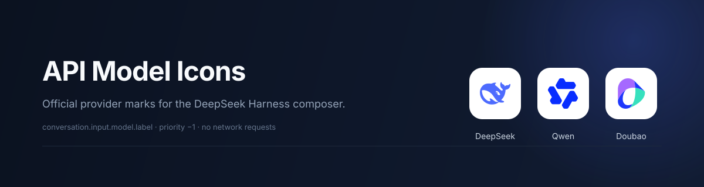

# DSH API Model Icons

[English](README.md) | [中文](README.zh.md)

> **Same series monorepo:** [`lizekun793-beep/dsh-plugins`](https://github.com/lizekun793-beep/dsh-plugins)
> - [dsh-live2d-pet](../dsh-live2d-pet/) — Live2D desktop pet
> - [dsh-custom-background](../dsh-custom-background/) — chat wallpaper
> - [dsh-image-gen](../dsh-image-gen/) — OpenAI-compatible image gen
> - [dsh-api-model-icons](./) — API provider marks in the model selector

Official provider marks in the DeepSeek Harness composer model selector.



## What it does

The composer's model menu groups models by API provider. This plugin puts that provider's
official mark in front of the model name everywhere the label is rendered:

- the model trigger in the composer toolbar;
- the current-model value in the model menu;
- every selectable model row.

| Provider | Mark |
| --- | --- |
| DeepSeek (official / account) |  |
| Qwen / 千问 (Aliyun Bailian) |  |
| Doubao / 豆包 (Volcengine) |  |
| Any other provider | neutral globe |

The artwork sits on a 16 px white tile with a 14 px mark. The white tile is nearly invisible
on the light theme and keeps the dark-blue Qwen and Doubao shapes readable on the dark theme.

## Install

Requirements:

- DeepSeek Harness with the Web app (`@deepseek-ai/dsh-web-app`).
- The shipped `@deepseek-ai/dsh-client-ui-model-selection` plugin, which declares the
  `conversation.input.model.label` slot.

1. Clone this repository.
2. Install the checkout as a bundle in the running profile with the Harness Plugin Manager
   (`install_bundle`), passing the absolute path to this directory. The bundle row is
   declared by [`cordis.patch.yml`](cordis.patch.yml); there is nothing to configure.
3. Refresh the Web page. The plugin appears in **Settings → Plugins** as
   **Model API Icons** (English) or **模型 API 图标** (Chinese).

The plugin is a profile bundle, so it applies to every session in that profile. It is a
Client-only module: the Host half is an empty `apply()`.

### From GitHub (monorepo, recommended)

```bash
dsh plugin --profile web add "github:lizekun793-beep/dsh-plugins#main&path:/dsh-api-model-icons" --registry=https://registry.npmmirror.com
```

Bundle package name in `dsh.profile.bundles`: `dsh-api-model-icons`. Then restart the profile and hard-refresh the browser.

## Verify

1. Open a session and click the model control at the bottom right of the composer.
2. The trigger, the **Model** value, and each model row show the provider mark before the
   model name.
3. DeepSeek-V4.1-Flash keeps the shipped `1017` release marker.
4. Unknown or newly added providers show the neutral globe instead of disappearing.

## How it works

The Client half registers into the single slot `conversation.input.model.label` with
`priority: -1`. In this slot the lowest priority renders, which lets the plugin decorate the
label that the model-selection package would otherwise render.

The Host supplies `provider`, `model`, `placement`, and `selected` owner props for each
placement. The component renders an inline `span` with the provider mark, the catalog model
name, and the optional `1017` marker. It makes no network requests, owns no state, and adds no
Host surface.

## Customize provider artwork

Provider matching lives in `iconKind()` in [`client.js`](client.js), and the path data lives in
the `LOGOS` object next to it. To add a provider:

1. Add a branch to `iconKind()` that recognizes the provider id or display name.
2. Add the SVG paths to `LOGOS` under that key.
3. Run `npm test` to validate the package shape.

Anything that does not match a known provider uses the globe fallback, so adding a provider
never removes its label.

## Compatibility and caveats

- Tested with DeepSeek Harness `0.2.1-rc.2` on the Web profile.
- `conversation.input.model.label` is a `single` slot. The plugin intentionally shadows the
  previous label occupant at a lower priority; another label plugin at the same priority will
  conflict, and the lowest priority wins.
- The shipped `1017` marker is reproduced for the exact route it was pinned to, so decorating
  the label does not remove it.
- This repository carries `"private": true` to prevent an accidental npm publish. Remove that
  field if you intend to publish.

## Trademarks and license

The plugin code is MIT-licensed; see [`LICENSE`](LICENSE).

The DeepSeek, Qwen, and Doubao marks are trademarks of their respective owners. They are used
here only to identify the configured API provider and do not imply endorsement. The SVG path
data is reproduced from [`@lobehub/icons-static-svg`](https://github.com/lobehub/lobe-icons)
1.97.0, which is MIT-licensed; see [`NOTICE.md`](NOTICE.md) and
[`THIRD_PARTY_LICENSES.md`](THIRD_PARTY_LICENSES.md).

If you redistribute this plugin, review each brand's trademark policy for your use case.
